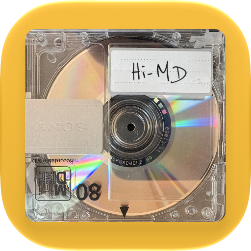

<p align="center">
  
</p>

<h1 align="center">Minidisc</h1>

<p align="center">
  A personal fork of <a href="https://github.com/Loriage/Minidisc">Minidisc</a>, the iOS music player for your own Subsonic or Navidrome server.
</p>

<p align="center">
  <a href="LICENSE"></a>
  <a href="#build-from-source"></a>
  <a href="https://swift.org"></a>
</p>

## About this fork

This repository is a fork of [Loriage/Minidisc](https://github.com/Loriage/Minidisc), which is itself a fork of [Cassette](https://github.com/CassetteLab/cassette) by Mathieu Dubart. Minidisc is a SwiftUI player for servers that speak the Subsonic or OpenSubsonic API, such as [Navidrome](https://www.navidrome.org). It has no accounts and no tracking: your music goes between your device and your server.

The fork follows its own direction and doesn't send changes upstream, but it merges upstream work from time to time. It is built for one person's library and devices and is shared as source only: there is no App Store listing, TestFlight or prebuilt `.ipa`. For the original app, its releases and its App Store listing, go to [upstream Minidisc](https://github.com/Loriage/Minidisc).

[FORK.md](FORK.md) has the details for anyone building or maintaining the fork: what differs from upstream, how upstream changes are merged, and what to keep when merging.

## What's different from upstream

**Playback**

- A single Playback settings page in Plexamp's order: Audio Output, Quality, Loudness Leveling, Crossfade, Downmix to Stereo, Equalizer, Autoplay and Caching.
- A 10-band equalizer with presets, a curve editor on AutoEQ's bands, and a search of [AutoEq](https://github.com/jaakkopasanen/AutoEq) headphone corrections.
- Loudness leveling with a preamp and a peak limiter.
- Autoplay with Album Direction (continue with similar music, or stop when a chosen album ends) and a choice of whether Autoplay songs count as plays.
- The two-deck engine keeps gapless playback and real crossfades through all of this.

**Buffering, caching and weak networks**

- Remote songs buffer four minutes ahead on both decks, and the playing song downloads in full from its first second.
- Upcoming songs are pre-cached per network, cellular included, along with recently played and pinned songs. A Caching page controls how far ahead.
- Streams above a per-network bitrate threshold are converted by the server; each cached copy remembers its quality.
- Stalls wait while data still arrives, then switch to a complete local copy when one is at least as good as the stream.
- An unreachable server counts as offline, and scrobbles wait until it is back. Cellular rules also apply through a VPN tunnel, such as Tailscale running over cellular.
- [docs/PlaybackContinuity.md](docs/PlaybackContinuity.md) describes the behaviour in detail.

**Apple platforms**

- Requires iOS 27 and publishes Now Playing through the iOS 27 NowPlaying framework.
- Widgets, Control Center controls and a download Live Activity.
- Siri and Shortcuts actions, Spotlight indexing of artists, albums and playlists, and plain-language library search with the on-device model.
- An Apple Watch remote, iPad and landscape layouts, and a Mac Catalyst build.
- CarPlay with Home, Library, Downloads and Moods tabs. It runs in the simulator; a device build needs Apple's CarPlay audio entitlement.
- A native Mac app with a Winamp mode (classic `.wsz` skins, docking playlist and equalizer windows) is in progress on the `feat/winamp-phase2` branch.

**Interface**

- A redesigned interface: a tile-based Library, a searchable Playlists tab, restyled album, playlist and artist screens, a mini player tinted from the cover, and an Accent Color setting.
- Full-screen karaoke lyrics, a sleep timer, and a spinning MiniDisc in place of the cover on tap.
- A photographed MiniDisc as the app icon (gold, with dark and light alternates), the logo and the no-artwork placeholder.

**Discovery**

- Album recommendations on Discover from Apple Intelligence on the device, or from Anthropic or OpenAI with your own API key. Missing albums link to Lidarr, Bandcamp and MusicBrainz.
- ListenBrainz is read-only here: plays reach ListenBrainz through the server's scrobbling, so the app doesn't submit them itself.

**Accessibility and quality**

- VoiceOver, Switch Control, Dynamic Type and Reduce Motion fixes, and a contrast sweep that brings text over covers and tinted surfaces to WCAG AA.
- Security, concurrency, memory, performance, energy, UX and accessibility audits, with their follow-ups, are in [docs/audits](docs/audits).

## Features from upstream

Everything upstream Minidisc offers is still here, including:

- A player close to Apple Music: a full-screen player, a mini player in the tab bar, Home shelves, background playback, lock screen and Control Center controls, and AirPlay.
- Your library: playlists, artists, albums, favourites synced with the server, search, offline downloads, lyrics, shuffle, repeat and a full queue.
- **Wrapped**, a summary of your year of listening.
- **AudioMuse-AI** mood playlists.
- **Lidarr**: add artists, search for missing albums, pick releases and follow the download queue.
- Lossless streaming by default, with a lighter format per network if you want one.

## Privacy

- Minidisc does not track you. Library and playback traffic goes directly to your server.
- Credentials are kept only in the Keychain. Custom HTTP headers are supported for servers behind a reverse proxy such as Cloudflare Access or Authelia.
- Some features talk to other services, and only when you use them:
  - LRCLIB, for lyrics: the track's title, artist, album and duration.
  - MusicBrainz, Wikidata and Wikimedia Commons, for artist images.
  - GitHub, to search AutoEq headphone corrections.
  - ListenBrainz, AudioMuse-AI and Lidarr, at the addresses you configure.
  - Anthropic or OpenAI, for recommendations. The names of recent and favourite albums, top artists and playlists are sent, and the app lists them and asks before the first request.
- Server credentials, custom headers and server identifiers are never sent to these services.

## Build from source

You need:

- A Mac with Xcode 27 or later.
- A Subsonic, OpenSubsonic or Navidrome server.
- For a device build, an Apple Developer account. The free personal team is enough, with the limits below.

Steps:

1. Clone the repository and open the project:

    ```bash
    git clone https://github.com/ecliptik/Minidisc.git
    cd Minidisc
    open Minidisc.xcodeproj
    ```

    Swift Package Manager fetches the only dependency, [SwiftSonic](https://github.com/MathieuDubart/swiftsonic).

2. Simulator builds need no signing setup: pick an iOS 27 simulator and press Command-R.

3. For a device, set your team in a local, git-ignored xcconfig instead of in the project:

    ```bash
    cp Config/Signing.local.xcconfig.example Config/Signing.local.xcconfig
    # then edit it: DEVELOPMENT_TEAM = <your 10-character team ID>
    ```

    `Config/Signing.xcconfig` is the project's base configuration and includes this file when it exists, so every target (app, widgets, watch app and tests) picks up your team. Xcode shows the team ID under Settings > Accounts.

4. The bundle IDs use the `com.ecliptik.minidisc` prefix and the App Group `group.com.ecliptik.minidisc`. Apple registers each bundle ID to only one team, so for a device build of your own copy, change the prefix everywhere `git grep com.ecliptik` finds it: the project, the entitlements files, `Info.plist`, `Shared/WidgetSnapshot.swift`, `BackgroundDownloadTransport.swift`, the UI tests and `Scripts/doctor.sh`.

5. On first launch, enter your server address, username and password and tap **Connect**. Headers for a reverse proxy go under **Advanced**.

A free personal team can't use the Siri capability, so the Siri entitlement is left out and Siri's own play requests go unused; App Shortcuts still work. It can also register only 10 new App IDs per 7 days, and the app, the widget extension and the watch app take three.

### Checks

```bash
./Scripts/doctor.sh            # project, privacy and packaging checks
./Scripts/doctor.sh --build    # also an unsigned Release build
```

Run the `MinidiscTests` scheme for unit tests. The UI tests in `MinidiscUITests` use a local fixture server, described in [Scripts/Testing/README.md](Scripts/Testing/README.md).

## Architecture

- **UI:** SwiftUI views with `@Observable @MainActor` view models; views hold no business logic.
- **Services:** Swift actors such as `PlayerService` and `LibraryService`, which import neither SwiftUI nor UIKit.
- **Playback:** a two-deck `AVPlayer` engine (`AVPlayerEngine`) for gapless playback, crossfades and ReplayGain, with an equalizer and loudness stage.
- **Subsonic API:** [SwiftSonic](https://github.com/MathieuDubart/swiftsonic).
- **Extensions:** `MinidiscWidgets` (widgets, controls, Live Activity) and `MinidiscWatch`, sharing code through `Shared/` and `WatchShared/`.
- **Persistence:** SwiftData for app data, the Keychain for credentials.
- **Concurrency:** Swift 6 strict concurrency.

## Issues

Report problems with this fork at [github.com/ecliptik/Minidisc/issues](https://github.com/ecliptik/Minidisc/issues). If a problem also happens in upstream Minidisc, report it there too.

## License

Minidisc is licensed under the [Mozilla Public License 2.0](LICENSE), like upstream Minidisc and Cassette. `LICENSE`, `NOTICE` and `COPYRIGHT` are upstream's and are kept unchanged. The fork's changes are also under MPL-2.0, and the source of every change is in this repository.

Third-party code and data, SwiftSonic and AutoEq (both MIT), are listed with their notices in [THIRD_PARTY_NOTICES.md](THIRD_PARTY_NOTICES.md).

> Code before upstream commit 21f9227 was licensed GPL-3.0-or-later.

"MiniDisc" is a trademark of Sony. This project is not affiliated with Sony, Apple, Nullsoft or the Winamp brand owners; those names are used only to describe the app.

## Acknowledgments

- [Minidisc](https://github.com/Loriage/Minidisc) by NO HIT Dev, which this repository forks.
- [Cassette](https://github.com/CassetteLab/cassette) by Mathieu Dubart, which Minidisc is a fork of.
- [SwiftSonic](https://github.com/MathieuDubart/swiftsonic) by Mathieu Dubart.
- [AutoEq](https://github.com/jaakkopasanen/AutoEq) by Jaakko Pasanen, for the headphone corrections.
- The [Navidrome](https://www.navidrome.org) team and the [OpenSubsonic](https://opensubsonic.netlify.app) community.
