<p align="center">
  
</p>

<h1 align="center">Hi-MD</h1>

<p align="center">
  A personal fork of <a href="https://github.com/Loriage/Minidisc">Minidisc</a>, the music player for your own Subsonic or Navidrome server, on iPhone, Apple Watch and Mac.
</p>

<p align="center">
  <a href="LICENSE"></a>
  <a href="#build-from-source"></a>
  <a href="https://swift.org"></a>
</p>

### "Hi-MD" Established: The Minidisc Music Player Has Evolved into a Versatile Listening App for the Self-Hosted Era

*October 2026* — ecliptik today announced the development of "Hi-MD," marking an evolution of the Minidisc music player into a versatile listening app that also delivers synced lyrics, an Apple Watch remote and a native Mac app, while maintaining playback compatibility with current Subsonic and Navidrome servers and keeping your music between your devices and your own server.

With the introduction of "Hi-MD," your Navidrome server is poised to meet the demands of a growing broadband era with a versatile player capable of playing a variety of content, such as music and lyrics, while maintaining high quality sound and resolution.

- **High capacity:** songs buffer four minutes ahead on both decks, and the playing one downloads in full from its first second; upcoming, recently played, pinned and favourite songs can be cached for offline listening, and albums download for the commute.
- **High quality sound:** original-quality streaming on Wi-Fi, so FLAC stays FLAC; gapless playback and real crossfades on a two-deck engine; a 10-band equalizer with AutoEq headphone corrections; loudness leveling.
- **Versatile recording media:** iPhone, iPad, Apple Watch and a native Mac app, where Miniamp, a compact skinnable player, loads classic Winamp 2 skins (.wsz). Album recommendations come from Apple Intelligence on the device.
- **Copyright protection technology:** no OpenMG, no MagicGate, no accounts and no tracking. Your server, your music.

ecliptik will proactively promote the "Hi-MD" format household-wide.

Hi-MD is a revamp of Minidisc, like [Hi-MD](https://www.minidisc.org/keep/sony_himd_announcement.pdf) was for the MiniDisc. It is an unofficial fork of [Loriage/Minidisc](https://github.com/Loriage/Minidisc), and it is not affiliated with or endorsed by Sony; MiniDisc and Hi-MD are Sony trademarks.

<p align="center">
  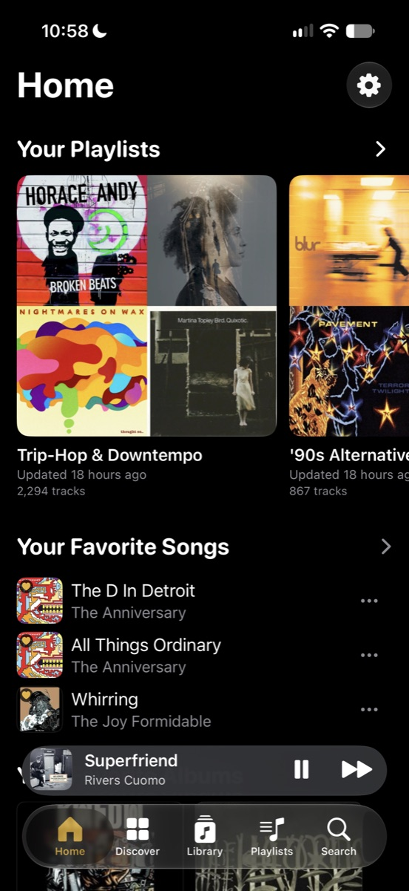&emsp;&emsp;
  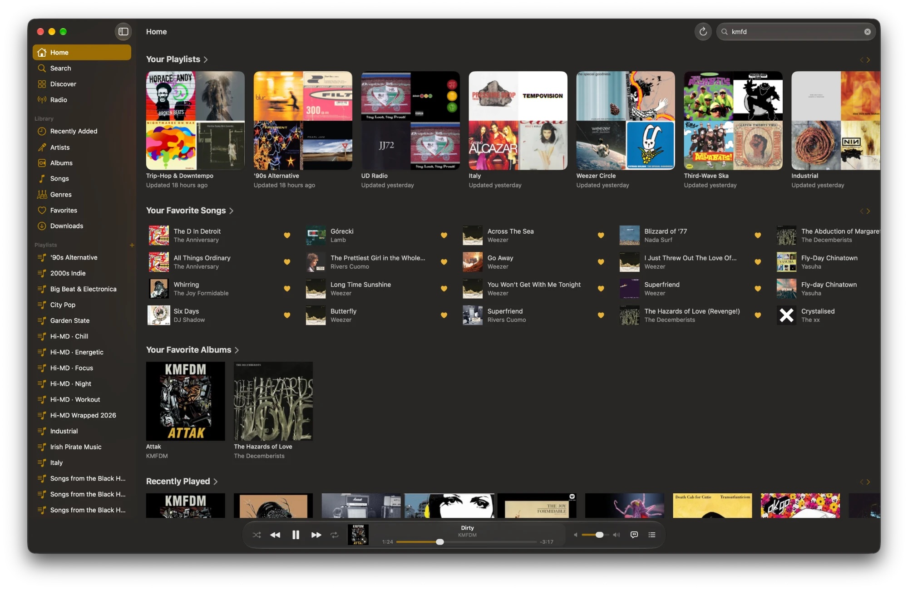
</p>

## Features

**Listening**

- An Apple Music–style player on iPhone, iPad, Apple Watch and Mac, with a full-screen player, synced and karaoke lyrics, a sleep timer and AirPlay.
- Gapless playback and real crossfades on a two-deck engine, lossless streaming on Wi-Fi with a lighter format per network, a 10-band equalizer with [AutoEq](https://github.com/jaakkopasanen/AutoEq) headphone corrections, and loudness leveling.
- Buffering built for weak networks: songs buffer minutes ahead, upcoming, favourite, recently played and pinned songs are cached for offline listening, and albums download for later. [docs/PlaybackContinuity.md](docs/PlaybackContinuity.md) has the details.

**Your library**

- Home shelves; Discover with artist stations, Smart Shuffle, moods and Wrapped; internet radio; and a library of albums, artists, songs, genres, playlists and favourites synced with your server.
- Album recommendations from Apple Intelligence on the device, or from Anthropic or OpenAI with your own key, checked against MusicBrainz and your library.
- Lidarr: add artists, find missing albums and follow the download queue. AudioMuse-AI mood playlists.

**On the Mac**

- A native Mac app with a Music-style library, a full-window Now Playing with lyrics, a MiniPlayer that shrinks down to a bar of controls, and a menu bar player, in Liquid Glass.
- Miniamp (View › Miniamp, ⌘⇧W): a compact player that loads classic Winamp 2 skins (`.wsz`), with playlist and equalizer windows and its own Hi-MD Gold skin.

**Across Apple platforms**

- Widgets, Control Center controls, a download Live Activity, Siri and Shortcuts, Spotlight, an Apple Watch remote, and CarPlay (a device build needs Apple's CarPlay audio entitlement).
- VoiceOver, Dynamic Type and Reduce Motion support, with text kept to WCAG AA contrast over covers and tinted surfaces.

## Screenshots

### iPhone

<table>
  <tr>
    <td align="center" width="25%">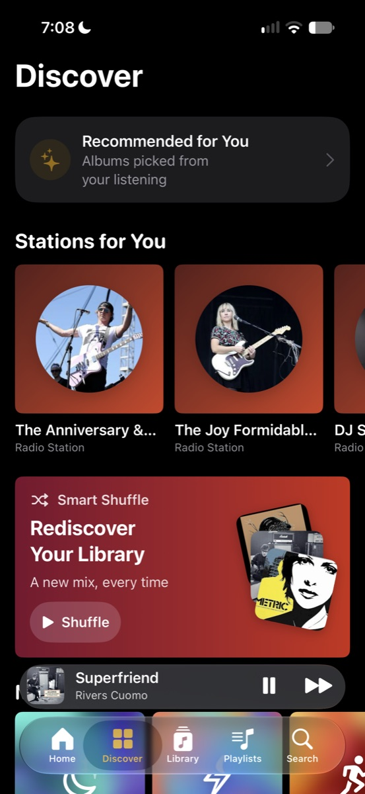<br>Discover</td>
    <td align="center" width="25%">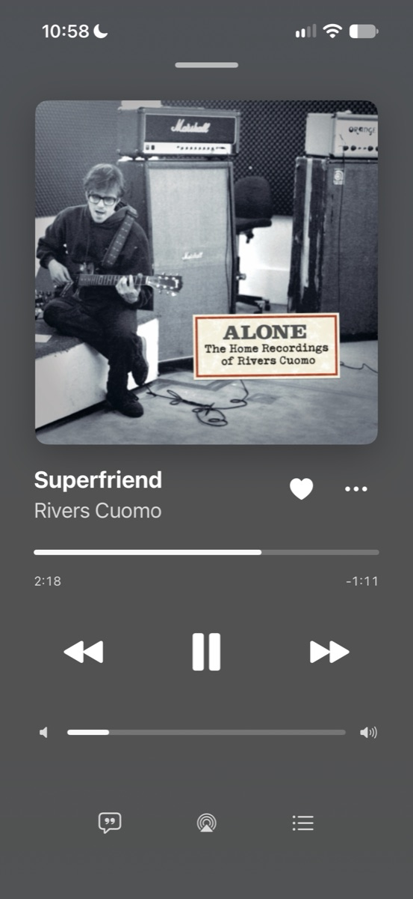<br>Now Playing</td>
    <td align="center" width="25%">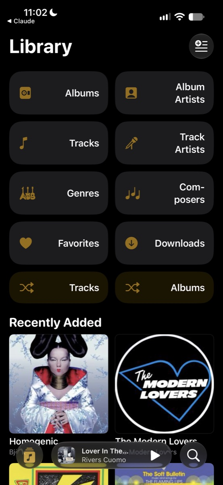<br>Library</td>
    <td align="center" width="25%">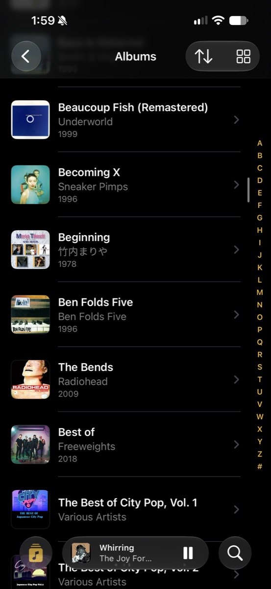<br>Albums</td>
  </tr>
  <tr>
    <td align="center" width="25%">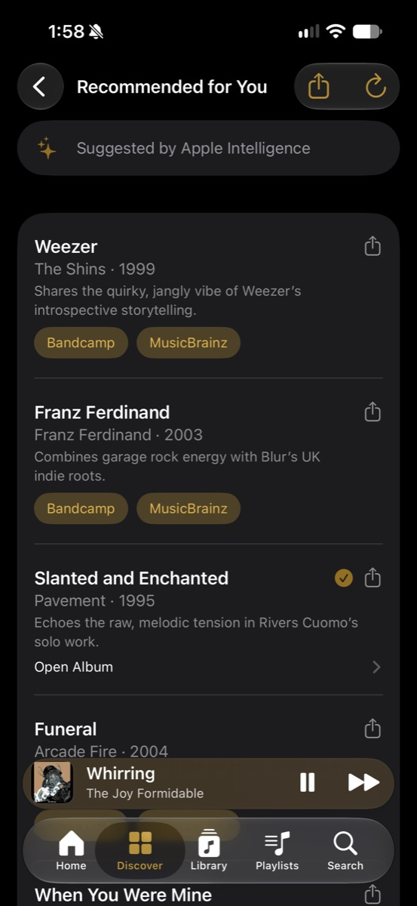<br>Recommendations</td>
    <td align="center" width="25%">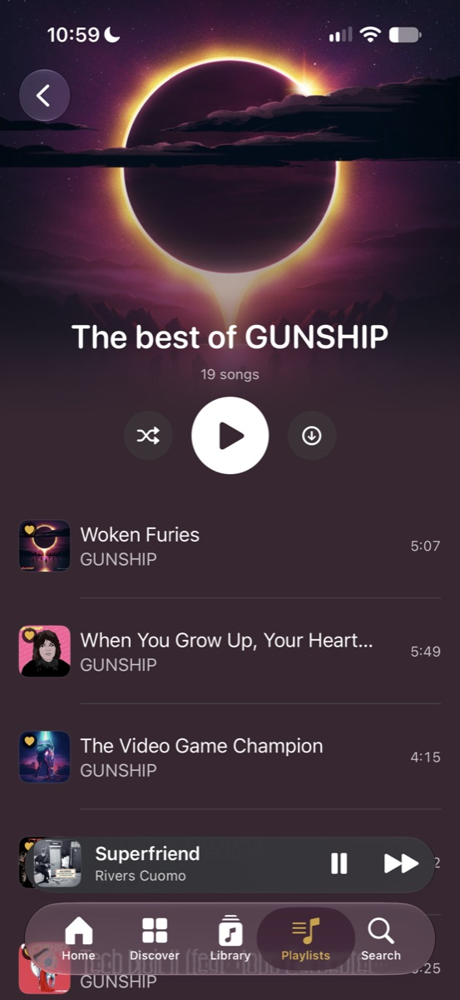<br>Playlist</td>
    <td align="center" width="25%">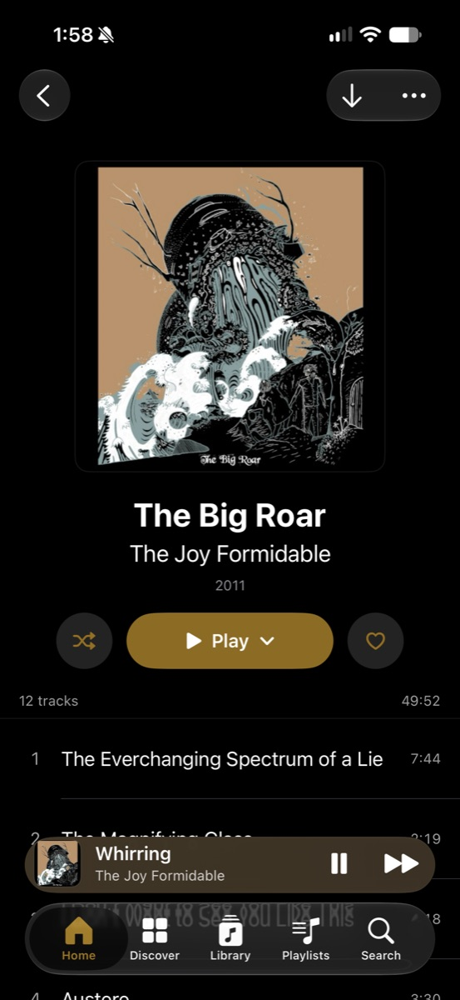<br>Album details</td>
    <td align="center" width="25%">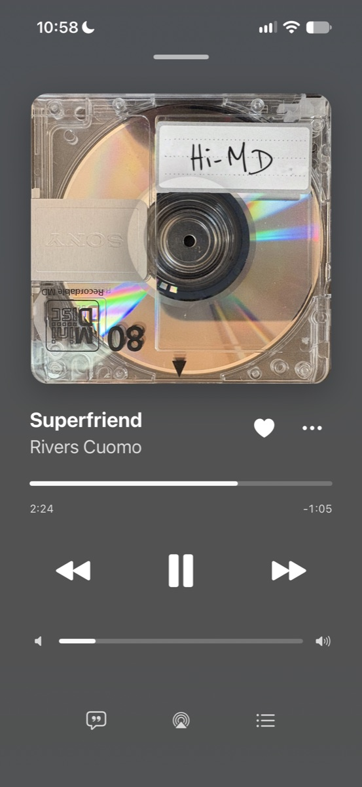<br>Just like a real MiniDisc</td>
  </tr>
</table>

### Mac

<table>
  <tr>
    <td align="center" width="50%">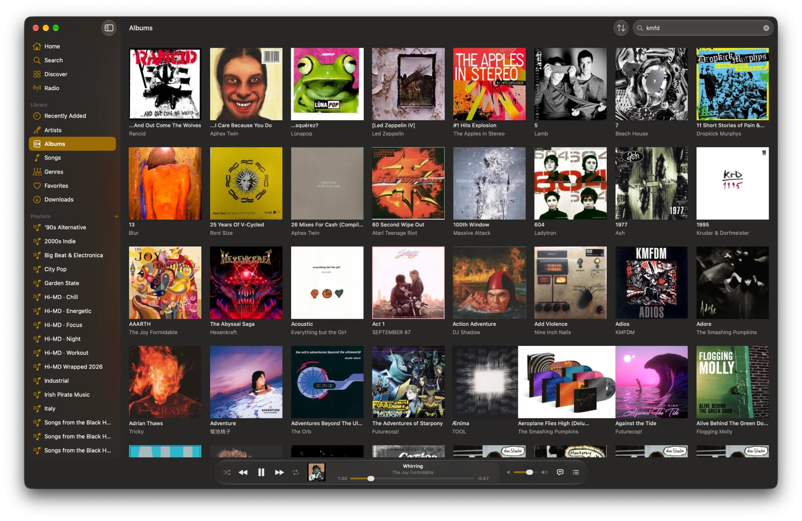<br>Albums</td>
    <td align="center" width="50%">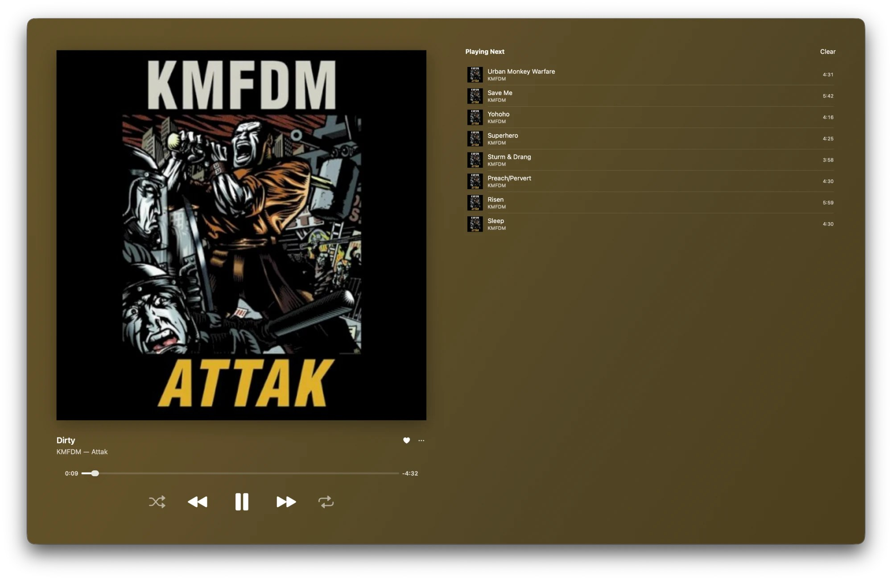<br>Now Playing</td>
  </tr>
  <tr>
    <td align="center" width="50%">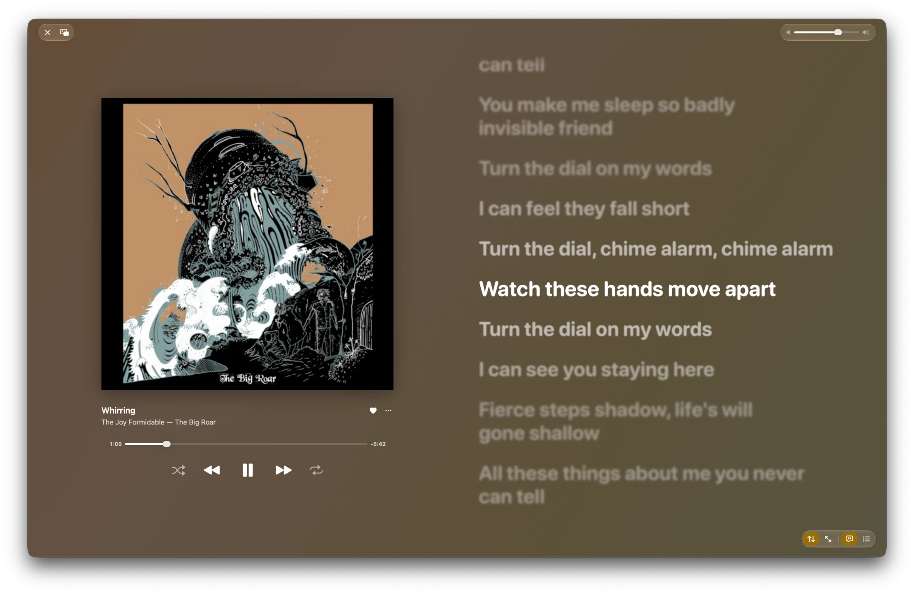<br>Synced lyrics</td>
    <td align="center" width="50%">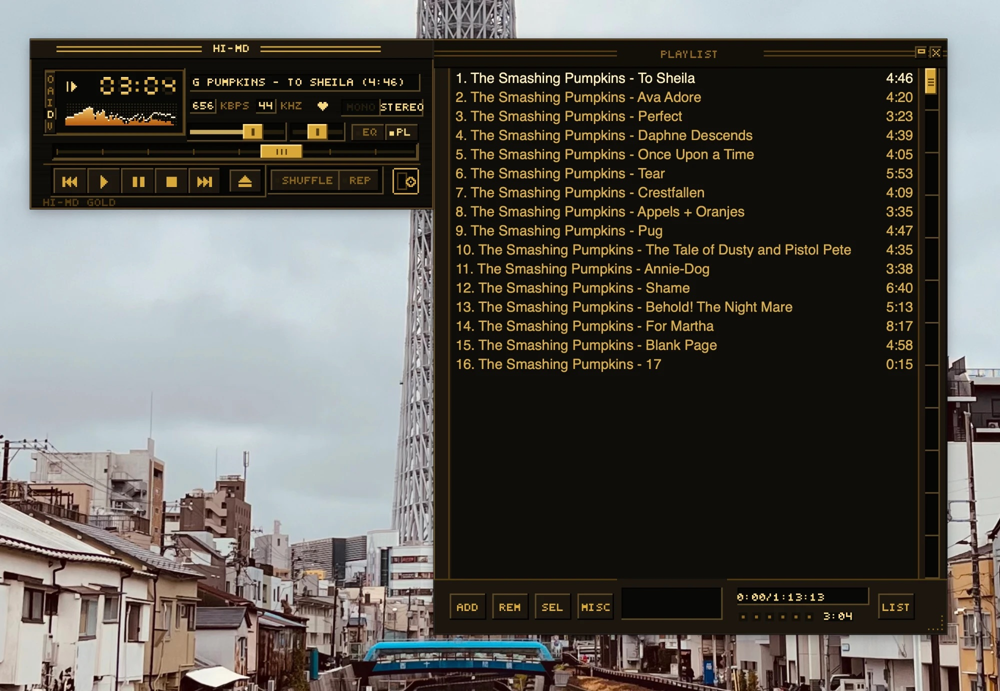<br>Miniamp, with the Hi-MD Gold skin</td>
  </tr>
</table>

## Privacy

- Hi-MD does not track you. Library and playback traffic goes directly to your server.
- Credentials are kept only in the Keychain. Custom HTTP headers are supported for servers behind a reverse proxy such as Cloudflare Access or Authelia.
- Some features talk to other services, and only when you use them:
  - LRCLIB, for lyrics: the track's title, artist, album and duration.
  - MusicBrainz, Wikidata and Wikimedia Commons, for artist images.
  - GitHub, to search AutoEq headphone corrections.
  - ListenBrainz, AudioMuse-AI and Lidarr, at the addresses you configure.
  - Anthropic or OpenAI, for recommendations. The names of recent and favourite albums, top artists and playlists are sent, and the app lists them and asks before the first request.
- Server credentials, custom headers and server identifiers are never sent to these services.

## Build from source

You need:

- A Mac with Xcode 27 or later.
- A Subsonic, OpenSubsonic or Navidrome server.
- For a device build, an Apple Developer account. The free personal team is enough, with the limits below.

Steps:

1. Clone the repository and open the project:

    ```bash
    git clone https://github.com/ecliptik/hi-md.git
    cd hi-md
    open Minidisc.xcodeproj
    ```

    The Xcode project, targets and schemes keep their original Minidisc names. Swift Package Manager fetches the only dependency, [SwiftSonic](https://github.com/MathieuDubart/swiftsonic).

2. Simulator builds need no signing setup: pick an iOS 27 simulator and press Command-R.

3. For a device, set your team in a local, git-ignored xcconfig instead of in the project:

    ```bash
    cp Config/Signing.local.xcconfig.example Config/Signing.local.xcconfig
    # then edit it: DEVELOPMENT_TEAM = <your 10-character team ID>
    ```

    `Config/Signing.xcconfig` is the project's base configuration and includes this file when it exists, so every target (app, widgets, watch app and tests) picks up your team. Xcode shows the team ID under Settings > Accounts.

4. The bundle IDs use the `com.ecliptik.minidisc` prefix and the App Group `group.com.ecliptik.minidisc`. Apple registers each bundle ID to only one team, so for a device build of your own copy, change the prefix everywhere `git grep com.ecliptik` finds it: the project, the entitlements files, `Info.plist`, `Shared/WidgetSnapshot.swift`, `BackgroundDownloadTransport.swift`, the UI tests and `Scripts/doctor.sh`.

5. On first launch, enter your server address, username and password and tap **Connect**. Headers for a reverse proxy go under **Advanced**.

A free personal team can't use the Siri capability, so the Siri entitlement is left out and Siri's own play requests go unused; App Shortcuts still work. It can also register only 10 new App IDs per 7 days, and the app, the widget extension and the watch app take three.

### Checks

```bash
./Scripts/doctor.sh            # project, privacy and packaging checks
./Scripts/doctor.sh --build    # also an unsigned Release build
```

Run the `MinidiscTests` scheme for unit tests. The UI tests in `MinidiscUITests` use a local fixture server, described in [Scripts/Testing/README.md](Scripts/Testing/README.md).

## Architecture

- **UI:** SwiftUI views with `@Observable @MainActor` view models; views hold no business logic.
- **Services:** Swift actors such as `PlayerService` and `LibraryService`, which import neither SwiftUI nor UIKit.
- **Playback:** a two-deck `AVPlayer` engine (`AVPlayerEngine`) for gapless playback, crossfades and ReplayGain, with an equalizer and loudness stage.
- **Subsonic API:** [SwiftSonic](https://github.com/MathieuDubart/swiftsonic).
- **Extensions:** `MinidiscWidgets` (widgets, controls, Live Activity) and `MinidiscWatch`, sharing code through `Shared/` and `WatchShared/`.
- **Persistence:** SwiftData for app data, the Keychain for credentials.
- **Concurrency:** Swift 6 strict concurrency.

## About this fork

Hi-MD began as a fork of [Loriage/Minidisc](https://github.com/Loriage/Minidisc), itself a fork of [Cassette](https://github.com/CassetteLab/cassette) by Mathieu Dubart, and was renamed Hi-MD in October 2026. It follows its own direction and doesn't send changes upstream, but merges upstream work from time to time.

It is shared as source only, with no App Store listing, TestFlight or prebuilt builds; for the original app, go to [upstream Minidisc](https://github.com/Loriage/Minidisc). [FORK.md](FORK.md) lists what differs from upstream and how upstream changes are merged.

## Issues

Report problems with this fork at [github.com/ecliptik/hi-md/issues](https://github.com/ecliptik/hi-md/issues). If a problem also happens in upstream Minidisc, report it there too.

## License

Hi-MD is licensed under the [Mozilla Public License 2.0](LICENSE), like upstream Minidisc and Cassette. `LICENSE`, `NOTICE` and `COPYRIGHT` are upstream's and are kept unchanged. The fork's changes are also under MPL-2.0, and the source of every change is in this repository.

Third-party code and data, SwiftSonic and AutoEq (both MIT), are listed with their notices in [THIRD_PARTY_NOTICES.md](THIRD_PARTY_NOTICES.md).

> Code before upstream commit 21f9227 was licensed GPL-3.0-or-later.

"MiniDisc" and "Hi-MD" are trademarks of Sony, and "Winamp" is a trademark of its owner. Hi-MD and Miniamp are not affiliated with or endorsed by Sony, Apple, Nullsoft, or Winamp and Llama Group; those names are used only to describe the app.

## Acknowledgments

- [Minidisc](https://github.com/Loriage/Minidisc) by [Loriage](https://github.com/Loriage) (NO HIT Dev), the original app this repository forks and renames Hi-MD.
- [Cassette](https://github.com/CassetteLab/cassette) by Mathieu Dubart, which Minidisc is a fork of.
- [SwiftSonic](https://github.com/MathieuDubart/swiftsonic) by Mathieu Dubart.
- [AutoEq](https://github.com/jaakkopasanen/AutoEq) by Jaakko Pasanen, for the headphone corrections.
- The [Navidrome](https://www.navidrome.org) team and the [OpenSubsonic](https://opensubsonic.netlify.app) community.
