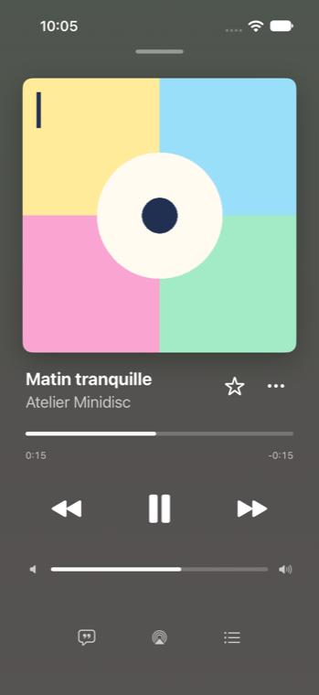
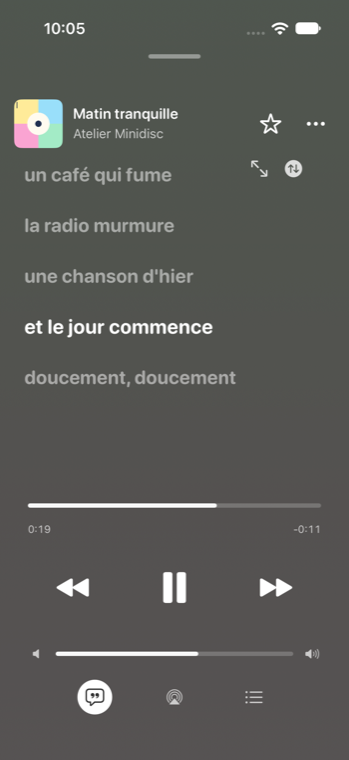
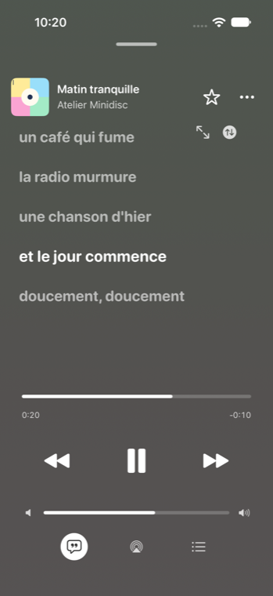
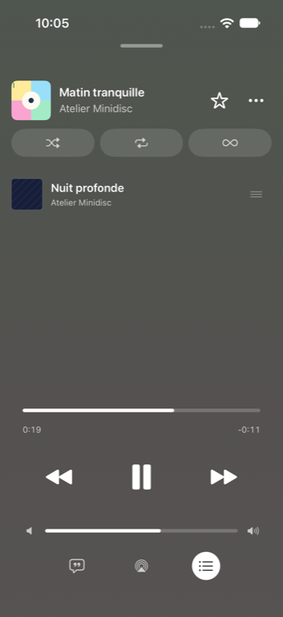
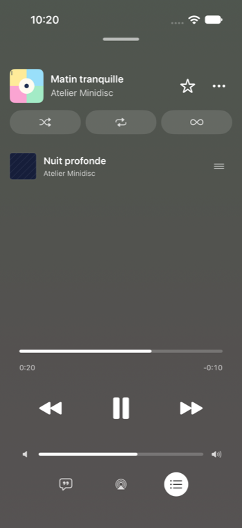
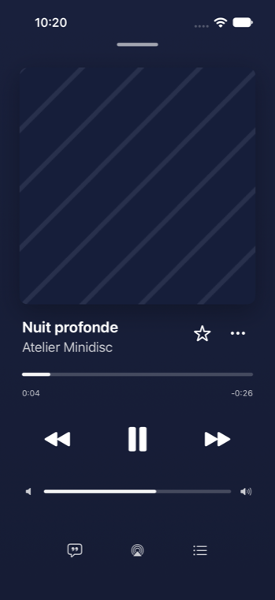

# Contrast sweep: 2026-10-26

**Summary:** 47 findings fixed across the full player, full-screen lyrics, the mini player, song rows, the Cover Colours detail screens, the artist information sheet, Wrapped, accent-coloured text and tertiary text. The worst before was white text at 1.4:1 on Cover Colours artist pages (bright green covers); the worst UI component was the active AirPlay glyph at 1.6:1. Every fixed text pair now reaches 4.5:1 (or 3:1 for large text and graphical objects) at its worst case, and new unit tests hold the ratios.

This follows the accessibility audit of 2026-10-25, whose HIGH items H1–H6 were fixed on main. This sweep covers what that audit left (M3 karaoke dimming, L8 secondary text) and what it didn't measure.

## Method

- Contrast is WCAG 2.x relative luminance, with translucent colours composited in gamma-encoded sRGB, as UIKit draws them. The thresholds are 4.5:1 for text, 3:1 for large text (18 pt, or 14 pt bold) and 3:1 for UI components and graphical objects (1.4.11).
- **Artwork backgrounds** have no single colour, so I used the worst case of the code that builds them. For the full player that means every colour on a 13-step sRGB grid, passed through the backdrop's luminance cap. The worst backdrop for white text turned out to be a saturated red band, not a bright cover: the cap keeps every stop at luminance 0.09 or below, but white at reduced opacity composites badly over red.
- **System colours:**
  - secondaryLabel is #3C3C43 at 60% (light) and #EBEBF5 at 60% (dark).
  - tertiaryLabel is the same colours at 30%.
  - The backgrounds are #FFFFFF and #F2F2F7 in light mode, and #000000, #1C1C1E and #2C2C2E in dark mode.
- **Light-mode Liquid Glass** under the mini player is modelled as #F2F2F7. Its real tone depends on the content behind it.
- **Screenshots:**
  - The repo's UX fixture (`Scripts/Testing/ux-fixture-server.py`) ran on a private port (18997), wrapped by a scratch script that served a bright four-colour cover and a dark navy cover.
  - A temporary UI test drove the app on a disposable iPhone 17 (iOS 27.0) simulator. It was erased before each run and deleted afterwards.
  - The test file wasn't committed. Measured ratios are read from the screenshots' pixels: the brightest text pixel against the adjacent backdrop.

## Findings

Ratios are worst case unless marked "measured". "Before" is commit 37d4263.

### Full player and lyrics (`6900a08`)

| # | Where | Before | After | Fix |
|---|---|---|---|---|
| P1 | Secondary text: artist, times, status, "Live Radio", queue artists, "Show More" (`FullPlayerViewModel.secondaryContentColor`) | 4.11 (white 70% on a saturated red band); measured 4.84 on the bright fixture cover | 4.88; measured 5.51 | `PlayerBackgroundPalette.secondaryOpacity` = 0.78 |
| P2 | Inactive toolbar glyphs (Lyrics, AirPlay, Queue), volume speaker icons | 4.11 | 4.88 | Same token (they needed 3:1 and already had it) |
| P3 | Dimmed lyric lines in the player (title2 bold, so large text) | 2.60; measured 3.30 | 3.28; measured 3.99 | `dimmedOpacity` = 0.6 (was 0.5) |
| P4 | Lyrics "No lyrics available", "Lyrics not supported" and error states (system secondary) | 2.87 | 4.88 | The player's secondary white |
| P5 | "Nothing up next" empty queue (EmptyStateView's system secondary) | 2.87 | 4.88 | New `EmptyStateView.secondaryStyle`; the player passes its secondary |
| P6 | Grabber / "Close player" (white 40%) | 2.01; measured 2.68 | 3.28; measured 3.97 | `dimmedOpacity` |
| P7 | Queue reorder handles (white 70% × 50%) | 1.76; measured 2.42 | 3.28; measured 4.00 | `dimmedOpacity`, threaded through `InlineQueueList` |
| P8 | Active AirPlay glyph (`activeTintColor` = accent fill) | 1.62 (worst accent) | 3.72 | The accent's dark text shade, resolved for dark whatever the device appearance |
| P9 | Queue-mode badge (accent fill on a black disc) | 4.54 (worst accent) | 10.43 | The accent's text shade |
| P10 | Inactive queue pill glyph (white 70% on a 12% white capsule) | 3.63 | 4.08 | Follows P1 (already passed 3:1) |
| P11 | Full-screen lyrics, line one away (largeTitle heavy, opacity 0.7) | 4.30 | 6.12 | 0.8 |
| P12 | Full-screen lyrics, two away (0.4) | 2.49 | 4.25 | 0.6 |
| P13 | Full-screen lyrics, three or more away (0.25), audit M3 | 1.81 | 3.47 | 0.5, plus a 45% scrim (was 35%). Increase Contrast or Reduce Transparency removes the blur and keeps every line at 0.8 or more |
| P14 | Full-screen lyrics artist line, "No lyrics available" (white 70%) | 4.30 | 5.91 | `secondaryOpacity` |

### Mini player (`4d3a6c6`)

| # | Where | Before | After | Fix |
|---|---|---|---|---|
| M1 | Artist and status lines on the cover tint (system secondary) | 2.88 | 5.23 | White at `secondaryOpacity` when tinted |
| M2 | Play and skip glyphs at the trailing end (tint fades to 55% over light glass) | 2.50 | 5.25 | The tint is capped like the player backdrop and fades only to 85% |
| M3 | Progress line on the tint (accent fill) | 1.6 | 3.7 or more | The accent's text shade when tinted |

### Song rows and badges over covers (`97622c2`)

| # | Where | Before | After | Fix |
|---|---|---|---|---|
| S1 | Durations (row secondary × 60%) | light 1.92, dark 2.81, black album screen 3.28 | 3.30 (system secondary), 5.27, 7.85 | Use the row's secondary colour itself |
| S2 | Downloaded icon (× 60%) | as S1 | as S1 | Same |
| S3 | Track numbers (× 72%) | light 2.24, dark 3.48 | 3.30, 5.27 | Same |
| S4 | Now-playing bars over a thumbnail (accent on a 45% scrim, white cover) | 1.37 | 3.98 | White bars on a 50% scrim |
| S5 | Favourite star on a thumbnail (accent straight on the artwork) | 1.0 on gold covers | 4.23 or more | A black 70% disc under the star, in the accent's dark text shade |
| S6 | Playing song title (`minidiscPlayingAccent` = the fill shade, used as text) | 3.69 on #1C1C1E (dark) | 4.5 or more (AccentContrastTests) | RootView and the player now provide the text shade |

### Accent-coloured text and tertiary text (`2fcf918`)

| # | Where | Before | After | Fix |
|---|---|---|---|---|
| T1 | `.bordered` buttons tinted with the fill accent (Favorites, Songs, Smart Search, Lidarr album, artist and release) | 3.0–4.4 (audit H2 method) | 4.5 or more | `.tint(.minidiscTextAccent)` |
| T2 | Gold text labels: "New Playlist", "Select", "Clear" (recent searches), "Turn Off Offline Mode", Lidarr release flags | 3.04–3.69 on grouped or raised rows in dark mode | 4.5 or more | `minidiscTextAccent` |
| T3 | Alphabet jump-bar letters (11 pt) | 3.69 on grouped rows (dark) | 4.5 or more | `minidiscTextAccent` |
| T4 | Copied error code and checkmark (CopyableCodeLabel) | ~4.2 on #0F0D0C (dark) | 4.5 or more | `MinidiscColors.textAccent` |
| T5 | MinidiscTextTertiary asset (#9C948F / #6E6560) | 2.69–3.41 on the Minidisc backgrounds | 3.12–3.65 (#908984 / #726A65) | Retuned for glyphs. Text moved to secondary (T6) |
| T6 | Onboarding "You can adjust everything…" footnote, the error code text (tertiary as text) | 2.69–3.41 | 4.75 or more (MinidiscTextSecondary) | Use the secondary asset |
| T7 | Album year in AlbumRow, "N tracks" in Downloads (system tertiary) | light 1.71, dark 2.25 | 3.30 / 5.27 | `.secondary` |
| T8 | "Already in the playlist" checkmark in Add Music (system tertiary, a state) | 1.71 / 2.25 | 3.30 / 5.27 | `.secondary` |
| T9 | Lidarr unmonitored badge on artist covers (white glyph straight on art) | ~1.0 on white covers | 5.7 | A black 60% disc behind the glyph |

### Cover Colours screens and the artist information sheet (`a4a1df0`)

| # | Where | Before | After | Fix |
|---|---|---|---|---|
| C1 | Artist, Best Of and Recently Added pages (PlaylistTheme): white text kept below a perceived brightness of 0.6 | 1.37 (bright green) | 4.5 or more | `ReadableContent` picks black or white by WCAG contrast |
| C2 | Same pages, 70% secondary text | 1.17 | 4.5 or more | Secondary opacity raised from 0.7 only as far as needed |
| C3 | Album Cover Colours palette, light mode, primary and secondary | 1.94 / 1.58 | 4.5 or more | ReadableContent over both gradient stops |
| C4 | Album Cover Colours palette, dark mode, primary and secondary | 4.03 / 2.83 | 4.5 or more | Same. In the narrow mid-tone band the stops are nudged darker or lighter |
| C5 | Album info footer (date, label: secondary × 82%) | cover colours: under 4.5 | equal to the palette secondary (4.5 or more) | Drop the extra 82% |
| C6 | Artist information sheet: name and facts over a gradient from the cover colour | 1.42 (white cover) | 7.5 or more | Gradient stops capped like the player backdrop |
| C7 | Artist information sheet: fact labels (white 44%) | under 1.5 on a white cover (4.25 even on black) | 4.88 | `secondaryOpacity` |
| C8 | Artist information sheet: biography (white 68%) | under 1.5 on a white cover | 4.88 | `secondaryOpacity` |

### Wrapped (`118d1a6`)

| # | Where | Before | After | Fix |
|---|---|---|---|---|
| W1 | Captions, kickers and units at 50–85% white (story slides, cards, share card, stat hero) | 2.19 (50%) to 3.77 (85%) | 4.89 | Stop cap 0.175 → 0.12; captions use `secondaryTextOpacity` = 0.85 |
| W2 | White text on 20% and 15% white chips and cards (play counts, Share, closing stats) | 3.21 / 3.51 | 4.68 | `chipFillOpacity` = 0.12 |
| W3 | Closing-slide stat labels (12 pt, 70% on a card) | 2.54 | 4.68 | Full white |
| W4 | Unavailable year cards faded to 70% over a light page | 2.70 | unchanged colours (6.2 or more) | Grayscale only |
| W5 | Non-medal rank badges over covers (primary on ultra-thin material) | depends on the cover; washes out on white art | 5.7 | White on black 60% |
| W6 | Rank numbers in Top Tracks (accent fill on a 15% accent tint) | 3.0–4.4 | 4.5 or more | `minidiscTextAccent` |
| W7 | White text on the gradient | 4.67 | 6.18 | Follows W1 |

## Judged fine or left alone

- **System secondaryLabel in light mode (3.30–3.44:1)** is Apple's own style, used on hundreds of rows. The audit's L8 says the same. It is left alone: replacing it would diverge from platform conventions, and iOS raises it with Increase Contrast. Rows the app had dimmed further (S1–S3) now sit at the system level.
- **The scrubber and volume tracks:** the unfilled track is white at 20% (1.25:1 to the backdrop). The 95% fill keeps 4.18:1 against the track and more against the backdrop, which is what conveys the value. Raising the track would cost fill-to-track contrast, as in Apple Music.
- **Disabled states:** the player's Play at 40% and scrubber at 40% when nothing can play, the mini player's controls at 30%, unavailable alphabet letters, and disabled menu items. Inactive components are exempt under 1.4.3, and the disabled state is also announced.
- **Decorative and redundant marks:**
  - disclosure chevrons in system tertiary (the whole row is tappable);
  - the Wrapped "·" separators;
  - the empty-state waveform icons;
  - the radio card's placeholder glyph at 25%;
  - the mood-card artwork glyph.
- **Placeholder text:** "Playlist Title" at 60% on the generated cover in the cover editor, before a title is typed.
- **The Smart Shuffle card:** white 85% on its gradient is 5.4:1 or more where the text sits (the left 60%), and 4.2:1 only at the far right edge, under the artwork.
- **Playlist detail:** the header's 65% and 70% secondary on PlaylistArtworkPalette (peak component 0.22) is 6:1 or more.
- **The active toolbar disc** (37d4263): a solid white disc with a black 80% glyph, 15:1 or more.
- **The queue pill's active state:** white on AccentRamp.v500, 4.90:1.
- **The black detail style:** white 62% on black, 7.85:1.
- **Brand gold fills and the app icon** are unchanged. Gold-as-text and small accent glyphs moved to the existing text shade.

## Screenshots

These are the full player over a bright four-colour cover and a dark navy cover, in a fixture library on an iOS 27.0 iPhone 17 simulator, French locale. Left is before (37d4263), right is after.

| | Before | After |
|---|---|---|
| Player, bright cover |  |  |
| Lyrics, bright cover |  |  |
| Queue, bright cover |  |  |
| Player, dark cover |  |  |

These are pixel measurements from the screenshots: the brightest text pixel against the backdrop next to it.

| Element | Before | After |
|---|---|---|
| Artist, bright cover | 4.84 | 5.51 |
| Elapsed time, bright cover | 4.86 | 5.58 |
| Artist, dark cover | 8.71 | 10.50 |
| Dimmed lyric line | 3.30 | 3.99 |
| Queue reorder handle | 2.42 | 4.00 |
| Grabber | 2.68 | 3.97 |

The bright pastel cover is not the worst case: its bands average to a grey backdrop. The worst cases (saturated reds for the player, bright greens for Cover Colours) come from the code's colour maths and are covered by the unit tests. The full-screen lyrics view didn't open reliably under XCTest, so it has no screenshot.

## Tests

New or changed suites:

- **PlayerContrastTests:**
  - the backdrop cap;
  - secondary text at 4.5:1;
  - dimmed content at 3:1;
  - the queue pill glyph;
  - the AirPlay tint for each accent;
  - `colors(from:)` uses the cap.
- **KaraokeContrastTests:** the dimmed lines and the artist line over the brightest full-screen backdrop.
- **ReadableContentTests:**
  - every colour on a 9-step grid gets 4.5:1 primary and secondary text;
  - gradients;
  - bright green gets black text;
  - dark colours are left alone;
  - mid tones move minimally;
  - PlaylistTheme;
  - Cover Colours album palettes in light and dark.
- **MinidiscTextColorTests:** the MinidiscTextSecondary and MinidiscTextTertiary assets on the three Minidisc backgrounds, in both appearances.
- **WrappedPaletteContrastTests:** captions, and chip text, over every stop and blend.

Also run: AccentContrastTests, ArtworkBandSamplerTests, CoverArtViewTests and HomeFeedContinuityTests.

## For the owner to check on device

- **The bars and playing title are brighter in dark mode.** Now-playing bars and the playing song's title use the accent's text shade, #E9B337 for gold in dark mode, instead of the deeper fill shade.
- **Cover Colours pages switch to black text more often.** On mid-tone covers (bright greens, yellows, light greys), artist and album pages now show black text, and a few mid-tone backgrounds are nudged slightly darker or lighter.
- **Wrapped gradients are about 15% darker.**
- **The mini player's tint** is darker and more even from left to right. Check it over light content in light mode, where the glass was modelled rather than measured.
- **Full-screen lyrics** have a slightly darker scrim, and the far lines are brighter. Turn on Increase Contrast to see the blur go.
- **The Mac build:** this base has no `MinidiscMac` scheme (it lives on `feat/macos-app`). The shared views were built for Mac Catalyst, but not for the native Mac target.
